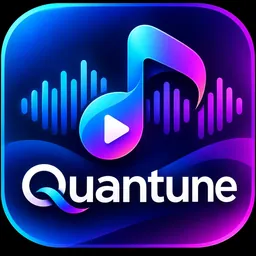

<!-- Quantune project README -->

  

<h1 align="center">Quantune</h1>

  <strong>Discover. Sync. Play.</strong> 
  A music experience for discovery, shared listening, song recognition, synchronized lyrics and a player you can make your own.
give a star if you like this project

  
  
  

  <a href="https://github.com/DS-ann/Quantune/releases/latest"><strong>Download Quantune</strong></a>
  &nbsp;·&nbsp;
  <a href="#whats-new">What's new</a>
  &nbsp;·&nbsp;
  <a href="#features">Features</a>
  &nbsp;·&nbsp;
  <a href="#build-from-source">Build from source</a>
  &nbsp;·&nbsp;
  <a href="https://github.com/DS-ann/Quantune/issues">Report an issue</a>

---

## Contents

- [About Quantune](#about-quantune)
- [What's new](#whats-new)
- [Download](#download)
- [Features](#features)
- [Installation and updates](#installation-and-updates)
- [Build from source](#build-from-source)
- [Technology](#technology)
- [Project structure](#project-structure)
- [Privacy and third-party services](#privacy-and-third-party-services)
- [Contributing and support](#contributing-and-support)
- [License](#license)

## About Quantune

**Quantune** is an Android music app built around the complete listening experience. Discover and play music, manage your personal library, recognize songs playing nearby, listen in sync with friends, and follow lyrics from a range of providers.

The app combines online playback with local music, playlists, favourites, listening history, audio caching, home-screen widgets and extensive player customization. Its interface and playback stack are designed to support older devices as well as newer Android versions.

| At a glance | Details |
|---|---|
| Platform | Android |
| Minimum Android version | **Android 6.0 Marshmallow · API 23** |
| Supported release ABIs | <code>armeabi-v7a</code>, <code>arm64-v8a</code> |
| Package ID | <code>com.dsann.music</code> |
| Release channel | [GitHub Releases](https://github.com/DS-ann/Quantune/releases) |
| License | Apache License 2.0 |

## What's new

### 🎧 Listen Together

Create or join a listening room and keep the session coordinated with friends. Quantune supports nearby rooms over the same Wi-Fi network or hotspot, as well as online rooms with a room code. Hosts can manage join requests while playback state and the shared queue stay synchronized.

### 🎙️ Song Recognition

Use the built-in Song Recognizer to identify music playing around you. Once a match is found, Quantune attempts to resolve it to a playable track so you can play it immediately, play it next, or add it to your queue.

### 🌍 AI Lyrics Translation

Translate lyrics from the player using a configurable translation service. Choose a provider, model, target language and translation options, or configure a custom endpoint. API credentials are stored separately using Android Keystore-backed encryption.

### 🎤 A richer lyrics experience

Follow line-synchronized lyrics or word-timed karaoke lyrics, with support for multiple lyric formats and provider integrations. The lyrics interface also includes translation controls and synchronization options.

### 🎛️ A more personal player

Customize the player’s appearance, typography, artwork, controls, gestures and other presentation settings. Playback queue controls, cover treatments and home-screen widgets make the listening experience easier to tailor.

---

## Download

  

Get the latest published build from the **[GitHub Releases page](https://github.com/DS-ann/Quantune/releases/latest)**. Select one APK that matches your device:

| APK | Device compatibility | Download | SHA-256 |
|---|---|---|---|
| **Universal ARM** | Most ARM phones and tablets; includes both supported ARM architectures | [Download](https://github.com/DS-ann/Quantune/releases/latest/download/Quantune-Universal.apk) | [Checksum](https://github.com/DS-ann/Quantune/releases/latest/download/Quantune-Universal.apk.sha256) |
| **ARMv7a** | 32-bit ARM devices · <code>armeabi-v7a</code> | [Download](https://github.com/DS-ann/Quantune/releases/latest/download/Quantune-armeabi-v7a.apk) | [Checksum](https://github.com/DS-ann/Quantune/releases/latest/download/Quantune-armeabi-v7a.apk.sha256) |
| **ARM64** | 64-bit ARM devices · <code>arm64-v8a</code> | [Download](https://github.com/DS-ann/Quantune/releases/latest/download/Quantune-arm64-v8a.apk) | [Checksum](https://github.com/DS-ann/Quantune/releases/latest/download/Quantune-arm64-v8a.apk.sha256) |

**Not sure which APK to choose?** Use the Universal ARM build. It bundles both ARM architectures; it is not an x86 or x86_64 package.

All three variants use the same application ID (<code>com.dsann.music</code>) and release signing key. Install only one variant at a time. Installing another variant replaces or updates the existing Quantune installation.

---

## Features

### Music discovery and playback

- Explore and search the online music catalogue through Quantune's YouTube Music integration.
- Play music with a dedicated player, playback queue and transport controls.
- Use track actions such as play next and add to queue.
- Browse local music stored on the device.
- Keep playlists, favourites and listening history together in your library.

### Listen Together

- Create or join a room for a shared listening session.
- Use nearby discovery over the same Wi-Fi network or hotspot.
- Connect to an online room using its room code.
- Set a display name, share a room PIN/code and manage incoming join requests.
- Synchronize shared playback state and the upcoming queue.

**Important:** Listen Together coordinates track information and playback; it does not stream the host's audio to other devices. Each participant needs to resolve and play the shared online track on their own device. Local-room traffic is not end-to-end encrypted.

### Song Recognizer

- Capture a short sample of nearby music using the device microphone.
- Identify a matching track through audio-fingerprint lookup.
- Resolve the result to a playable Quantune track when a match is available.
- Play the result, play it next, add it to the queue, or open supported music-service details.

The recognition flow creates a compact audio fingerprint on the device and sends that fingerprint for matching; the raw microphone recording is not uploaded by this feature. Microphone permission is required when recognition is used.

### Lyrics and translation

- Display plain lyrics, line-synchronized lyrics and word-timed karaoke lyrics.
- Parse supported timed-lyrics formats including **LRC, TTML, QRC and YRC**.
- Use the available lyrics-provider integrations, which include YouTube Music, Apple Music/Better Lyrics, QQ Music, NetEase, KuGou and LRCLIB.
- Adjust synchronization and lyrics presentation from the player.
- Translate lyrics through configurable AI services.

AI translation settings include provider, model, target language, translation mode, custom endpoint and prompt options. Available provider entries include OpenRouter, OpenAI, Perplexity, Claude, Gemini, xAI, Mistral, Inception, DeepL and custom services. Provider availability and model IDs can change; some services require a separate API key or paid account.

### Personal library and offline listening

- Organize playlists, favourites and listening history.
- Browse and play supported local audio files.
- Cache supported online tracks for later playback.
- Download supported audio in the available formats.
- View and manage cached or downloaded content from the library experience.

Offline availability depends on the selected track, format, provider and successful completion of the cache or download operation.

### Player customization

Personalize the listening interface with settings for:

- Player layout, artwork shape and artwork scale.
- Theme, colours, typography and text presentation.
- Playback controls and control styles.
- Gestures and player interaction.
- Lyrics appearance, alignment and synchronization.
- Playback animation and progress presentation.

### Home-screen widgets

Quantune registers three resizable Android home-screen widget layouts:

| Widget | Target size | Use |
|---|---:|---|
| **Quantune Aura** | 2 × 2 | Compact playback controls |
| **Quantune Bridge** | 4 × 2 | Track details and playback controls |
| **Quantune Dashboard** | 4 × 4 | Expanded music-control layout |

---

## Installation and updates

1. Open the [latest Quantune release](https://github.com/DS-ann/Quantune/releases/latest).
2. Download the APK for your device architecture, or choose **Universal ARM**.
3. Open the downloaded APK and follow Android's installation prompt.
4. Launch Quantune and grant permissions when you use features that need them.

Android may ask you to allow installation from the app used to open the APK. This is a system setting, not a Quantune account requirement.

### Updating an existing installation

Download the newer APK from the [Releases page](https://github.com/DS-ann/Quantune/releases) and install it over the current version. Keep the same package ID and release signature. Uninstalling first is normally unnecessary and may remove local app data.

---

## Build from source

Quantune is an Android Gradle project. The official release workflow uses:

| Tool | Version |
|---|---|
| JDK | 17 |
| Gradle | 9.3.1 |
| Android SDK Platform | 37 |
| Android NDK | 27.2.12479018 |
| CMake | 3.22.1 |

### 1. Clone the repository

<pre><code>git clone https://github.com/DS-ann/Quantune.git
cd Quantune</code></pre>

### 2. Build the release APKs

<pre><code>./gradlew assembleRelease</code></pre>

On Windows:

<pre><code>gradlew.bat assembleRelease</code></pre>

The ABI split configuration produces a Universal ARM APK, an ARMv7a APK and an ARM64 APK. Gradle writes the outputs under:

<pre><code>app/build/outputs/apk/release/</code></pre>

### 3. Publish a signed release

For an official signed release, use the **manual GitHub Actions workflow**:

[**Actions → Publish Quantune Android Release**](https://github.com/DS-ann/Quantune/actions/workflows/release.yml)

The workflow builds all three APK variants, signs and verifies them, generates SHA-256 checksum files and attaches the assets to a GitHub Release. Release signing credentials are supplied through repository Actions secrets and are not stored in the source tree.

The workflow is started manually; ordinary pushes to the repository do not publish a release.

### Versioning

The app version is defined in <code>version.properties</code>. The release workflow reads this file to determine the Android version name, version code and release tag.

---

## Technology

Quantune uses Android platform components and Kotlin libraries, including:

- **Kotlin** and **Jetpack Compose** for application and interface code.
- **AndroidX** for compatibility, lifecycle, navigation and UI infrastructure.
- **Media3 / ExoPlayer** for playback and media-session integration.
- **NewPipe Extractor** for online stream extraction.
- **Room** for local structured data.
- **Hilt** for dependency injection.
- **Retrofit** and **OkHttp** for network requests.
- **Glide** and **Coil** for image loading.
- **CMake / Android NDK** for native build components.

---

## Project structure

| Path | Purpose |
|---|---|
| <code>app/src/main/java/com/dsann/music/data/</code> | Online integrations, local data, collaboration and lyrics providers |
| <code>app/src/main/java/com/dsann/music/service/</code> | Playback service and media-session behaviour |
| <code>app/src/main/java/com/dsann/music/ui/</code> | Player, Listen Together, Song Recognizer, Explore, Library, Settings and widgets |
| <code>app/src/main/res/</code> | Android icons, resources, themes, layouts and widget definitions |
| <code>assets/</code> | Project artwork |
| <code>.github/workflows/</code> | Manual build and release automation |

---

## Privacy and third-party services

Quantune connects to third-party music, lyrics, recognition and translation services. Their availability, APIs, catalogues, pricing and terms can change independently of this project.

- **Song Recognition:** the feature creates an audio fingerprint locally and sends the fingerprint for matching. The raw microphone sample is not uploaded by the recognition implementation.
- **AI Lyrics Translation:** lyrics are sent to the translation provider configured by the user. API credentials are stored separately using Android Keystore-backed encryption.
- **Listen Together:** local-room traffic is not end-to-end encrypted. The feature synchronizes track information and playback state; it does not relay audio.
- **Online music and lyrics:** results and availability depend on third-party providers and the content they make available.

**Quantune is an independent project. It is not affiliated with, endorsed by, or sponsored by Google, YouTube or YouTube Music.** YouTube and YouTube Music are trademarks of Google LLC. Other names and marks belong to their respective owners.

Use the app and third-party services in accordance with applicable laws, provider terms and the rights of content owners. Users are responsible for ensuring they have the rights and permissions required for content they access or save.

---

## Contributing and support

Use [GitHub Issues](https://github.com/DS-ann/Quantune/issues) to report bugs or request features.

For a useful bug report, include:

- Device model and Android version.
- Quantune release tag and APK architecture.
- What you expected and what happened instead.
- Steps to reproduce the issue.
- A relevant crash log, with private information removed.

Please search existing issues before opening a duplicate. Feature requests are most useful when they explain the problem being solved and the behaviour you expect.

---

## License

Quantune is distributed under the **Apache License 2.0**. See [LICENSE](LICENSE) for the full license text.

Third-party libraries and services remain subject to their own licenses and terms.

---

  <strong>Quantune</strong> 
  Discover. Sync. Play.  
  <a href="https://github.com/DS-ann/Quantune/releases/latest">Download</a>
  &nbsp;·&nbsp;
  <a href="https://github.com/DS-ann/Quantune/issues">Issues</a>
  &nbsp;·&nbsp;
  <a href="https://github.com/DS-ann/Quantune/blob/main/LICENSE">Apache 2.0</a>

