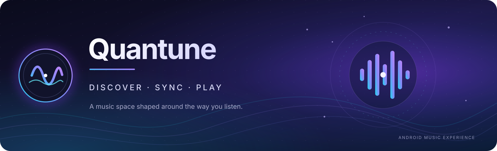

<!--
  Quantune — Android music player
  Keep links relative where possible so this README remains correct across branches.
-->

<p align="center">
  
</p>

<p align="center">
  <a href="https://github.com/DS-ann/Quantune/releases/latest">
    
  </a>
  <a href="https://github.com/DS-ann/Quantune/blob/main/LICENSE">
    
  </a>
  
  <a href="https://github.com/DS-ann/Quantune/actions/workflows/release.yml">
    
  </a>
</p>

<p align="center">
  <strong>Discover music. Follow every word. Make it yours.</strong><br>
  An Android music experience bringing online discovery, synchronized lyrics, personal listening, and a deeply customizable player together.
</p>

<p align="center">
  <a href="https://github.com/DS-ann/Quantune/releases/latest"><strong>Get Quantune</strong></a>
  &nbsp;·&nbsp;
  <a href="#features">Explore features</a>
  &nbsp;·&nbsp;
  <a href="#build-from-source">Build from source</a>
  &nbsp;·&nbsp;
  <a href="https://github.com/DS-ann/Quantune/issues">Report a problem</a>
</p>

---

## What is Quantune?

**Quantune** is an Android music app built around the full listening session—not just the play button. Explore and play music, keep a personal library, work with playlists and listening history, follow timed lyrics, and shape the player to suit the way you listen.

The project is designed to support a wide Android range, with **Android 6.0 (API 23) as its minimum version** and dedicated ARM builds for both 32-bit and 64-bit devices.

## Download

<p align="center">
  <a href="https://github.com/DS-ann/Quantune/releases/latest">
    
  </a>
</p>

The latest published release is available from the [GitHub Releases page](https://github.com/DS-ann/Quantune/releases/latest). Choose **one** APK for your device:

| APK | Use this on | Download |
|---|---|---|
| **Universal ARM** | Most ARM Android phones and tablets. Includes both supported ARM architectures. | [Quantune-Universal.apk](https://github.com/DS-ann/Quantune/releases/download/18.7.0/Quantune-Universal.apk) |
| **ARMv7a** | 32-bit ARM devices (`armeabi-v7a`). | [Quantune-armeabi-v7a.apk](https://github.com/DS-ann/Quantune/releases/download/18.7.0/Quantune-armeabi-v7a.apk) |
| **ARM64** | 64-bit ARM devices (`arm64-v8a`). | [Quantune-arm64-v8a.apk](https://github.com/DS-ann/Quantune/releases/download/18.7.0/Quantune-arm64-v8a.apk) |

Each APK has a matching **SHA-256 checksum** in the same release. Open the release page to get the APK and its checksum together.

> **Which one should I choose?** Use the Universal ARM APK when you are unsure. It contains ARMv7a and ARM64 libraries; it is **not** a universal x86/x86_64 build.

All three variants use the same Android application ID, `com.dsann.music`, and the same release signing key. Install only one variant at a time; installing another variant updates/replaces the existing Quantune installation.

### Compatibility at a glance

| Detail | Value |
|---|---|
| Platform | Android |
| Minimum Android | Android 6.0 Marshmallow · API 23 |
| Supported APK ABIs | `armeabi-v7a`, `arm64-v8a` |
| Package ID | `com.dsann.music` |
| Release channel | [GitHub Releases](https://github.com/DS-ann/Quantune/releases) |

---

## Features

### Music discovery and playback
- Explore and search the online music catalogue through the app's YouTube Music integration.
- Play music with a dedicated player, playback queue, and standard transport controls.
- Keep a personal listening space with playlists, favourites, and listening history.
- Browse music available on the device and open supported audio files with Quantune.

### Synchronized lyrics
- Lyrics are a first-class part of the listening experience, with line-synchronized and word-timed karaoke presentation.
- The lyrics pipeline includes parsers for formats such as **LRC, TTML, QRC, and YRC**.
- Provider integrations in the codebase include **YouTube Music, Apple Music via Better Lyrics, QQ Music, NetEase, KuGou, and LRCLIB**.
- Lyrics availability and timing quality depend on the track and the third-party provider. A track may have no lyrics or only unsynchronized text.

### Your player, your layout
- Customize the listening interface with appearance, typography, artwork, control, and gesture preferences.
- Use the queue and playback controls without leaving the listening session.
- Choose between different visual treatments for player elements and progress presentation.

### Offline and personal library
- Quantune includes audio caching and metadata handling to support playback of cached content.
- Manage local music, playlists, favourites, and listening history from the library experience.
- Cache and offline availability depend on the selected track, format, and whether the content has finished caching.

### Home-screen widgets
Three widget layouts are registered in the app:

| Widget | Size | Designed for |
|---|---:|---|
| **Quantune Aura** | 2 × 2 | Compact playback controls |
| **Quantune Bridge** | 4 × 2 | Track details and playback |
| **Quantune Dashboard** | 4 × 4 | A larger music-control surface |

---

## Installation

1. Open [the latest release](https://github.com/DS-ann/Quantune/releases/latest).
2. Download the APK that matches your device, or choose **Universal ARM**.
3. Open the downloaded APK and follow Android's installation prompt.
4. Launch Quantune and grant only the permissions needed for the features you use.

On Android, the system may ask you to allow installation from the app used to open the APK. This is an Android setting, not a Quantune account requirement.

### Updating

Download a newer APK from the [Releases page](https://github.com/DS-ann/Quantune/releases) and install it over the existing app. Keep the same package ID and release signature; do not uninstall first unless you intentionally want to remove the app's local data.

---

## Build from source

Quantune is an Android Gradle project. The release workflow currently builds with:

- **JDK 17**
- **Gradle 9.3.1**
- **Android SDK Platform 37**
- **Android NDK 27.2.12479018**
- **CMake 3.22.1**

Clone the repository:

```bash
git clone https://github.com/DS-ann/Quantune.git
cd Quantune
```

Build the release variants:

```bash
./gradlew assembleRelease
```

On Windows, use:

```bat
gradlew.bat assembleRelease
```

Gradle writes the APK outputs under:

```text
app/build/outputs/apk/release/
```

The ABI split configuration produces a Universal ARM APK, an ARMv7a APK, and an ARM64 APK. For a signed public release, use the repository's **manual GitHub Actions workflow**:

[**Actions → Publish Quantune Android Release**](https://github.com/DS-ann/Quantune/actions/workflows/release.yml)

The release workflow builds the variants, signs and verifies each APK, generates SHA-256 files, and attaches the six assets to a GitHub Release. Signing credentials are supplied through repository Actions secrets and are not part of the source tree.

---

## Technology

Quantune is built with a mix of Android platform components and Kotlin libraries, including:

- **Kotlin** and **Jetpack Compose** for application and interface code.
- **AndroidX** components for app compatibility, lifecycle, navigation, and UI infrastructure.
- **Media3 / ExoPlayer** for media playback and media-session integration.
- **NewPipe Extractor** for the app's YouTube-stream extraction integration.
- **Room** for local structured data.
- **Hilt** for dependency injection.
- **Retrofit** and **OkHttp** for network requests.
- **Glide** and **Coil** for image loading.
- **CMake / NDK** for native build components.

---

## Project structure

A quick map of the codebase:

| Path | Purpose |
|---|---|
| `app/src/main/java/com/dsann/music/data/` | Data, online integration, local storage, and lyrics providers |
| `app/src/main/java/com/dsann/music/service/` | Playback service and media-session behaviour |
| `app/src/main/java/com/dsann/music/ui/` | Player, Explore, Library, Settings, and widget interfaces |
| `app/src/main/res/` | Android resources, themes, layouts, and widget definitions |
| `.github/workflows/` | Manual build and release automation |

---

## Reporting bugs and requesting features

Use [GitHub Issues](https://github.com/DS-ann/Quantune/issues). For a useful bug report, include:

- Device model and Android version.
- Quantune release tag and APK architecture.
- What you expected to happen and what happened instead.
- Reproduction steps and a relevant crash log, with private information removed.

Please search existing issues before opening a duplicate. Feature requests are most useful when they describe the problem being solved, not only a proposed implementation.

---

## Service, content, and attribution

Quantune integrates with third-party music and lyrics services. Their availability, APIs, catalogues, and terms can change independently of this project. Service-specific features may stop working or behave differently if a provider changes its systems.

**Quantune is an independent project. It is not affiliated with, endorsed by, or sponsored by Google, YouTube, or YouTube Music.** YouTube and YouTube Music are trademarks of Google LLC. Other product and service names belong to their respective owners.

Use the app and any third-party services in accordance with applicable laws, provider terms, and the rights of content owners. Users are responsible for ensuring they have the rights and permissions required for content they access or save.

---

## License

Quantune is distributed under the **Apache License 2.0**. See [`LICENSE`](LICENSE) for the complete license text.

Third-party libraries and services remain subject to their own licenses and terms.

---

<p align="center">
  <strong>Quantune</strong><br>
  <sub>Discover. Sync. Play.</sub><br><br>
  <a href="https://github.com/DS-ann/Quantune/releases/latest">Download</a>
  &nbsp;·&nbsp;
  <a href="https://github.com/DS-ann/Quantune/issues">Issues</a>
  &nbsp;·&nbsp;
  <a href="https://github.com/DS-ann/Quantune/blob/main/LICENSE">Apache 2.0</a>
</p>
